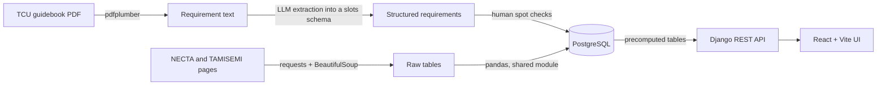

# SkuliNode

**School results software for Tanzania, plus open education-data tools built from official NECTA and TCU sources.**

> **Status: paused.** Built solo. It is not currently hosted, so there is no live demo. This README and the source code are the demo. Nothing here claims users or revenue.

SkuliNode is two products on one codebase:

- **School management app (multi-tenant):** teachers enter marks, and the system computes grades, divisions, points and class ranks, then produces the mkeka (results sheet), PDF report cards and parent SMS notifications.
- **Public data tools (no login):** a NECTA results explorer, a TCU admission calculator and a Markdown blog, built from scraped and structured official sources.

It was used for a real end-of-year marks entry at a Tanzanian school: the mkeka and report cards were printed and handed to teachers.

## Why it exists

Many schools still compute results by hand or in spreadsheets, and parents get a number on paper weeks later. At the same time, national exam data is published as thousands of separate web pages, and university entry requirements sit in a long PDF guidebook. SkuliNode puts both in a form people can actually use: results a school can print and send the same day, and public data a student can search, compare and share.

## Highlights

- **Multi-tenant:** every record is scoped to a school.
- **NECTA-style grading:** grades, points, divisions, averages and per-stream ranks, with configurable grade scales per school (NECTA defaults as fallback).
- **PDF output:** mkeka and report cards via ReportLab, with school logos.
- **Parent SMS** through NextSMS, with a dry-run mode and an `SMSLog` record of each message.
- **NECTA explorer:** school rankings, subject leaderboards, gender comparison, head-to-head school comparison and shareable image cards.
- **TCU calculator:** enter your subjects and grades, get the programmes you qualify for.
- **No LLM at runtime.** An LLM was used once to extract entry requirements from the guidebook, and a deterministic engine decides eligibility.

## Features

### School management
- Classes, streams, subjects and teacher-subject assignments
- Mark entry per assessment, with per-student subject exclusions
- Grades, points, divisions, averages and class ranking (primary and secondary formats)
- Mkeka and report card PDFs
- Finance tracking and teacher comments
- Parent SMS notifications with logging
- JWT authentication (60 minute access token, 7 day rotating refresh) with admin and teacher roles

### Public tools
- **NECTA Results Explorer:** ACSEE results for several years, by school and by subject
- **TCU Admission Calculator:** programme requirements parsed from the official guidebook, enriched with ownership and category data
- **Blog:** Markdown posts with SEO metadata

## Architecture



## Engineering decisions worth reading

- **Compute once, serve precomputed.** Heavy analysis runs at import time. The API only reads tables, so public pages stay fast on a small server.
- **No LLM at runtime.** Each extracted requirement keeps a verbatim `raw_requirement_text` for grounding, and I spot-checked results by hand. Eligibility is decided by a deterministic backtracking engine that finds the best assignment of the student's subjects to the programme's requirement slots.
- **Statistics done carefully.** GPAs are weighted by candidates sat. Pass rate uses graded candidates (sum of divisions) as the denominator, which fixed a pass rate that exceeded 100%. Gender comparisons report ties as ties instead of declaring a winner. Schools with incomplete source data are flagged and excluded from rankings.
- **One pandas module** is used in both the analysis notebook and Django, so exploration and production cannot disagree.
- **Built for the audience.** Swahili SMS text, mobile-first pages, and share cards for the places results actually get passed around.

## Tech stack

| Layer | Tools |
|---|---|
| Backend | Django 4.2, Django REST Framework, SimpleJWT, WhiteNoise, python-decouple |
| Database | PostgreSQL via dj-database-url |
| Data | requests, BeautifulSoup, pdfplumber, pandas, Gemini Flash-Lite for one-time extraction |
| PDFs and images | ReportLab, Pillow |
| Frontend | React 18, Vite, Tailwind CSS v4, react-router, axios, recharts, react-markdown, lucide-react |
| Media (optional) | Cloudinary via django-cloudinary-storage |
| SMS | NextSMS |
| Ops | nginx, gunicorn, Let's Encrypt, GitHub Actions |

## Project structure

```
backend/
  config/            settings and urls
  core/              schools, users, auth
  api/               REST endpoints
  academy/           marks, grading, PDFs, SMS
  necta_results/     NECTA models, services, admin CSV upload, share cards
  tcu_calculator/    programmes, requirements, eligibility engine, import commands
  blog/              Markdown blog
frontend/
  src/
    api/             axios client with refresh-token interceptor
    config/          API base URLs
    context/         auth state
    components/
    pages/
```

## Getting started

**Requirements:** Python 3, Node.js and PostgreSQL.

```bash
# Backend
cd backend
python -m venv env
source env/bin/activate        # Windows: .\env\Scripts\Activate.ps1
pip install -r requirements.txt
# create backend/.env (see Configuration below)
python manage.py migrate
python manage.py createsuperuser
python manage.py runserver

# Frontend (new terminal)
cd frontend
npm install
npm run dev
```

The API runs on `http://localhost:8000`. The Vite dev server proxies `/api` and `/media` to it.

### Configuration

Settings are read from `backend/.env`:

| Setting | Purpose |
|---|---|
| `SECRET_KEY` | Django secret key |
| `DEBUG` | `True` for development |
| `ALLOWED_HOSTS`, `CORS_ALLOWED_ORIGINS` | Comma-separated hosts and origins |
| `DATABASE_URL` or `DB_*` | PostgreSQL connection |
| `USE_CLOUDINARY` and Cloudinary keys | Optional media storage |
| `SMS_DRY_RUN` | `True` logs messages instead of sending them |
| `NEXTSMS_USERNAME`, `NEXTSMS_PASSWORD`, `NEXTSMS_SENDER_ID` | SMS credentials |

**Never commit a real `.env` file.**

### Loading the public datasets

```bash
# TCU
python manage.py import_tcu_data --year="2026/2027"
python manage.py enrich_tcu_data
python manage.py compute_tcu_insights
# then publish the dataset in Django admin
```

NECTA results are loaded by CSV upload in Django admin.

## Known limitations

- Not hosted right now, so there is no live demo.
- SMS is sent synchronously inside the request. A large broadcast to a whole school should move to a background queue with batching and delivery tracking.
- CSEE 2025 is not loaded yet. The scraper needs two fixes first (school name and GPA column selectors).
- TCU application links are entered manually in admin.
- Parent access is by SMS only. There is no parent portal.

## What I'd do next

- Background SMS queue with throttling and delivery status
- CSEE, FTNA and PSLE results
- OTP-based parent portal
- School directory
- Past papers

## Data sources and disclaimer

Public data comes from the National Examinations Council of Tanzania (NECTA), the Tanzania Commission for Universities (TCU) and PO-RALG / TAMISEMI. SkuliNode is an independent project and is **not affiliated with or endorsed by** any of them. Always check official publications before making decisions.

## License

MIT. See [LICENSE](LICENSE).

## Author

Built by **Manfred Baraka** · manfredbaraka33@gmail.com
